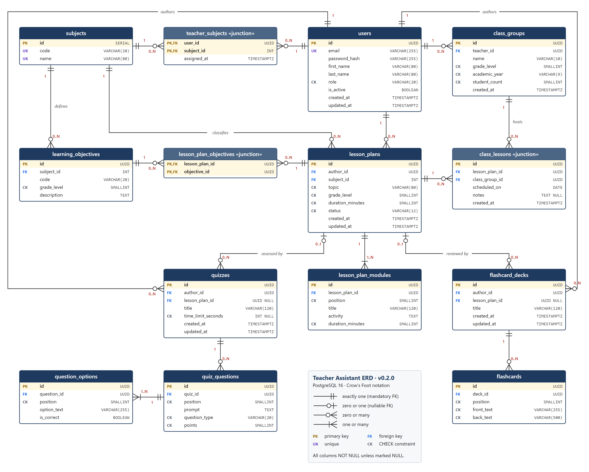

# Teacher Assistant: Database Schema and Design Justification

**Deliverable 2 (v0.2.0).** ERD, relational schema and architectural justification
**Team:** Shattyk Rahmetolla, Assel Sergazy
**DBMS:** PostgreSQL 16 · **ORM:** Prisma 6 · **Notation:** Crow's Foot

| Artifact | Location |
| --- | --- |
| Visual ERD (vector) | [`docs/erd.pdf`](./erd.pdf) |
| Visual ERD (raster / source) | [`docs/erd.png`](./erd.png), [`docs/erd.svg`](./erd.svg) |
| Executable ORM schema | [`prisma/schema.prisma`](../prisma/schema.prisma) |
| SQL migration (tables, indexes, FKs, CHECKs) | [`prisma/migrations/20261106000000_init/migration.sql`](../prisma/migrations/20261106000000_init/migration.sql) |
| Sample data | [`prisma/seed.sql`](../prisma/seed.sql) |
| Previous design (v0.1, kept for the normalization narrative) | [`docs/legacy/erd-v0.1.jpg`](./legacy/erd-v0.1.jpg) |

---

## 1. Domain Scope

Teacher Assistant reduces teacher workload. A teacher creates **short-term lesson plans (ҚМЖ)**
linked to the state curriculum's learning objectives, schedules them for **class groups**, and
reuses them to build **quizzes** (Quiz Arena) and **flashcard decks** (Flashcards game).

The schema covers these domain areas:

| Area | Tables |
| --- | --- |
| Identity and reference data | `users`, `subjects`, `teacher_subjects`, `class_groups`, `learning_objectives` |
| Lesson planning | `lesson_plans`, `lesson_plan_objectives`, `lesson_plan_modules`, `class_lessons` |
| Assessment and edu-games | `quizzes`, `quiz_questions`, `question_options`, `flashcard_decks`, `flashcards` |

**Out of scope for v0.2.0:** the Presentation Builder and the worksheet generator do not
have tables yet. They will be added as children of `lesson_plans` in a later migration. Student
accounts and quiz attempts are also out of scope, because the current product targets teachers
running games in class.

### Conventions

- Table and column names are `snake_case`. Prisma models map to them with `@@map` / `@map`.
- Surrogate primary keys are `UUID` (`gen_random_uuid()`). `subjects` is a small, stable lookup
  table and uses `SERIAL` (`INTEGER`), which keeps its foreign keys narrow.
- Every column is `NOT NULL` unless the table marks it `NULL`.
- Timestamps are `TIMESTAMPTZ(6)`. `created_at` defaults to `now()`. Prisma `@updatedAt` sets
  `updated_at` on every write.
- Enumerated values are stored as `VARCHAR` with a `CHECK` list, not as PostgreSQL `ENUM`
  types, so new values can be added without an `ALTER TYPE` migration.
- Prisma cannot express `CHECK` constraints. They are added by hand at the end of the init
  migration, and every one is listed in Section 3.

---

## 2. Entity-Relationship Diagram



How to read the diagram:

- **PK** = primary key (highlighted row), **FK** = foreign key, **UK** = unique,
  **CK** = column guarded by a `CHECK` constraint. `NULL` after a type marks a nullable column.
- Crow's Foot ends: `||` exactly one, `o|` zero or one, `o<` zero or many, `|<` one or many.
  Each end also carries a text label (`1`, `0..1`, `0..N`, `1..N`).
- Headers in a lighter colour with «junction» mark the tables that resolve many-to-many
  relationships.

---

## 3. Entity and Attribute Specification

### 3.1 `users`

A person who signs in. Teachers author all content. Admins manage reference data.

| Column | SQL type | Constraints | Description |
| --- | --- | --- | --- |
| `id` | `UUID` | PK, default `gen_random_uuid()` | Surrogate identifier. |
| `email` | `VARCHAR(255)` | NOT NULL, UNIQUE, CHECK `users_email_format_chk` (`x@y.z` shape) | Login name. |
| `password_hash` | `VARCHAR(255)` | NOT NULL | bcrypt hash. Plain passwords are never stored. |
| `first_name` | `VARCHAR(80)` | NOT NULL, CHECK `users_names_not_blank_chk` | Given name. |
| `last_name` | `VARCHAR(80)` | NOT NULL, CHECK `users_names_not_blank_chk` | Family name. |
| `role` | `VARCHAR(20)` | NOT NULL, default `'TEACHER'`, CHECK `IN ('TEACHER','ADMIN')` | Authorization role. |
| `is_active` | `BOOLEAN` | NOT NULL, default `true` | Soft deactivation flag (see 5.3). |
| `created_at` | `TIMESTAMPTZ(6)` | NOT NULL, default `now()` | Registration time. |
| `updated_at` | `TIMESTAMPTZ(6)` | NOT NULL | Last profile change. |

### 3.2 `subjects`

Lookup table of school subjects.

| Column | SQL type | Constraints | Description |
| --- | --- | --- | --- |
| `id` | `SERIAL` (`INTEGER`) | PK | Surrogate identifier. |
| `code` | `VARCHAR(20)` | NOT NULL, UNIQUE, CHECK `^[A-Z0-9_]{2,20}$` | Stable machine code, e.g. `MATH`. |
| `name` | `VARCHAR(80)` | NOT NULL, UNIQUE | Display name, e.g. `Mathematics`. |

### 3.3 `teacher_subjects` (junction, N:M `users` ↔ `subjects`)

| Column | SQL type | Constraints | Description |
| --- | --- | --- | --- |
| `user_id` | `UUID` | PK (part 1), FK → `users.id` ON DELETE CASCADE | The teacher. |
| `subject_id` | `INTEGER` | PK (part 2), FK → `subjects.id` ON DELETE RESTRICT | The taught subject. |
| `assigned_at` | `TIMESTAMPTZ(6)` | NOT NULL, default `now()` | When the subject was added to the profile. |

### 3.4 `class_groups`

A class that a teacher works with in one academic year, e.g. *7A, 2026-2027*.

| Column | SQL type | Constraints | Description |
| --- | --- | --- | --- |
| `id` | `UUID` | PK | Surrogate identifier. |
| `teacher_id` | `UUID` | NOT NULL, FK → `users.id` ON DELETE CASCADE | Owning teacher. |
| `name` | `VARCHAR(10)` | NOT NULL | Class label, e.g. `7A`. |
| `grade_level` | `SMALLINT` | NOT NULL, CHECK `BETWEEN 0 AND 12` | School grade (0 = pre-school class). |
| `academic_year` | `VARCHAR(9)` | NOT NULL, CHECK `YYYY-YYYY` with consecutive years | e.g. `2026-2027`. |
| `student_count` | `SMALLINT` | NOT NULL, default `0`, CHECK `BETWEEN 0 AND 60` | Used to size printed materials. |
| `created_at` | `TIMESTAMPTZ(6)` | NOT NULL, default `now()` | Creation time. |
| | | UNIQUE (`teacher_id`, `name`, `academic_year`) | One "7A" per teacher per year. |

### 3.5 `learning_objectives`

Curriculum learning objectives (оқу мақсаттары) that lesson plans target.

| Column | SQL type | Constraints | Description |
| --- | --- | --- | --- |
| `id` | `UUID` | PK | Surrogate identifier. |
| `subject_id` | `INTEGER` | NOT NULL, FK → `subjects.id` ON DELETE RESTRICT | Owning subject. |
| `code` | `VARCHAR(20)` | NOT NULL | Curriculum code, e.g. `5.1.2.1`. |
| `grade_level` | `SMALLINT` | NOT NULL, CHECK `BETWEEN 0 AND 12` | Grade the objective belongs to. |
| `description` | `TEXT` | NOT NULL | Objective wording. |
| | | UNIQUE (`subject_id`, `code`) | Codes repeat across subjects, so they are unique only within a subject. |

### 3.6 `lesson_plans`

A short-term lesson plan (ҚМЖ), produced by the lesson-plan generator.

| Column | SQL type | Constraints | Description |
| --- | --- | --- | --- |
| `id` | `UUID` | PK | Surrogate identifier. |
| `author_id` | `UUID` | NOT NULL, FK → `users.id` ON DELETE RESTRICT | Teacher who created the plan. |
| `subject_id` | `INTEGER` | NOT NULL, FK → `subjects.id` ON DELETE RESTRICT | Subject of the plan. |
| `topic` | `VARCHAR(80)` | NOT NULL, CHECK `btrim(topic) <> ''` | Lesson topic. The 80-char limit matches the frontend rule FR-03. |
| `grade_level` | `SMALLINT` | NOT NULL, CHECK `BETWEEN 0 AND 12` | Grade the plan is written for. |
| `duration_minutes` | `SMALLINT` | NOT NULL, default `45`, CHECK `BETWEEN 10 AND 180` | Planned lesson length. |
| `status` | `VARCHAR(12)` | NOT NULL, default `'DRAFT'`, CHECK `IN ('DRAFT','PUBLISHED','ARCHIVED')` | Lifecycle state. |
| `created_at` | `TIMESTAMPTZ(6)` | NOT NULL, default `now()` | Creation time (dashboard sort key). |
| `updated_at` | `TIMESTAMPTZ(6)` | NOT NULL | Last edit. |

### 3.7 `lesson_plan_objectives` (junction, N:M `lesson_plans` ↔ `learning_objectives`)

| Column | SQL type | Constraints | Description |
| --- | --- | --- | --- |
| `lesson_plan_id` | `UUID` | PK (part 1), FK → `lesson_plans.id` ON DELETE CASCADE | The plan. |
| `objective_id` | `UUID` | PK (part 2), FK → `learning_objectives.id` ON DELETE RESTRICT | Targeted objective. |

### 3.8 `lesson_plan_modules`

Ordered stages of a lesson plan (starter, main activity, reflection, …). These are the cards
the frontend renders.

| Column | SQL type | Constraints | Description |
| --- | --- | --- | --- |
| `id` | `UUID` | PK | Surrogate identifier. |
| `lesson_plan_id` | `UUID` | NOT NULL, FK → `lesson_plans.id` ON DELETE CASCADE | Parent plan. |
| `position` | `SMALLINT` | NOT NULL, CHECK `>= 1` | Order inside the plan. |
| `title` | `VARCHAR(120)` | NOT NULL | Stage title. |
| `activity` | `TEXT` | NOT NULL | Activity description. |
| `duration_minutes` | `SMALLINT` | NOT NULL, CHECK `BETWEEN 1 AND 180` | Stage length. |
| | | UNIQUE (`lesson_plan_id`, `position`) | No two stages share a slot. |

### 3.9 `class_lessons` (junction with payload, N:M `lesson_plans` ↔ `class_groups`)

A dated delivery of a plan to a class. This replaces the v0.1 `tblDate` table.

| Column | SQL type | Constraints | Description |
| --- | --- | --- | --- |
| `id` | `UUID` | PK | Surrogate identifier. Notes and future attendance can refer to it. |
| `lesson_plan_id` | `UUID` | NOT NULL, FK → `lesson_plans.id` ON DELETE RESTRICT | Plan being taught. |
| `class_group_id` | `UUID` | NOT NULL, FK → `class_groups.id` ON DELETE CASCADE | Class receiving the lesson. |
| `scheduled_on` | `DATE` | NOT NULL | Lesson date. |
| `notes` | `TEXT` | NULL | Teacher's notes for this delivery. |
| `created_at` | `TIMESTAMPTZ(6)` | NOT NULL, default `now()` | Creation time. |
| | | UNIQUE (`class_group_id`, `scheduled_on`, `lesson_plan_id`) | The same plan cannot be booked twice for one class on one day. |

### 3.10 `quizzes`

A multiple-choice quiz for the Quiz Arena game.

| Column | SQL type | Constraints | Description |
| --- | --- | --- | --- |
| `id` | `UUID` | PK | Surrogate identifier. |
| `author_id` | `UUID` | NOT NULL, FK → `users.id` ON DELETE RESTRICT | Owner. |
| `lesson_plan_id` | `UUID` | NULL, FK → `lesson_plans.id` ON DELETE SET NULL | Source plan. `NULL` for standalone quizzes. |
| `title` | `VARCHAR(120)` | NOT NULL | Quiz title. |
| `time_limit_seconds` | `INTEGER` | NULL, CHECK `NULL OR BETWEEN 30 AND 7200` | Optional timer. |
| `created_at` | `TIMESTAMPTZ(6)` | NOT NULL, default `now()` | Creation time. |
| `updated_at` | `TIMESTAMPTZ(6)` | NOT NULL | Last edit. |

### 3.11 `quiz_questions`

| Column | SQL type | Constraints | Description |
| --- | --- | --- | --- |
| `id` | `UUID` | PK | Surrogate identifier. |
| `quiz_id` | `UUID` | NOT NULL, FK → `quizzes.id` ON DELETE CASCADE | Parent quiz. |
| `position` | `SMALLINT` | NOT NULL, CHECK `>= 1` | Order in the quiz. |
| `prompt` | `TEXT` | NOT NULL | Question text. |
| `question_type` | `VARCHAR(20)` | NOT NULL, default `'SINGLE_CHOICE'`, CHECK `IN ('SINGLE_CHOICE','MULTIPLE_CHOICE','TRUE_FALSE')` | Answer mode. |
| `points` | `SMALLINT` | NOT NULL, default `1`, CHECK `BETWEEN 1 AND 100` | Score weight. |
| | | UNIQUE (`quiz_id`, `position`) | Stable ordering. |

### 3.12 `question_options`

| Column | SQL type | Constraints | Description |
| --- | --- | --- | --- |
| `id` | `UUID` | PK | Surrogate identifier. |
| `question_id` | `UUID` | NOT NULL, FK → `quiz_questions.id` ON DELETE CASCADE | Parent question. |
| `position` | `SMALLINT` | NOT NULL, CHECK `>= 1` | Display order (A, B, C…). |
| `option_text` | `VARCHAR(255)` | NOT NULL | Answer text. |
| `is_correct` | `BOOLEAN` | NOT NULL, default `false` | Whether the option is a correct answer. |
| | | UNIQUE (`question_id`, `position`) | Stable ordering. |

### 3.13 `flashcard_decks`

| Column | SQL type | Constraints | Description |
| --- | --- | --- | --- |
| `id` | `UUID` | PK | Surrogate identifier. |
| `author_id` | `UUID` | NOT NULL, FK → `users.id` ON DELETE RESTRICT | Owner. |
| `lesson_plan_id` | `UUID` | NULL, FK → `lesson_plans.id` ON DELETE SET NULL | Source plan. `NULL` for standalone decks. |
| `title` | `VARCHAR(120)` | NOT NULL | Deck title. |
| `created_at` | `TIMESTAMPTZ(6)` | NOT NULL, default `now()` | Creation time. |
| `updated_at` | `TIMESTAMPTZ(6)` | NOT NULL | Last edit. |

### 3.14 `flashcards`

| Column | SQL type | Constraints | Description |
| --- | --- | --- | --- |
| `id` | `UUID` | PK | Surrogate identifier. |
| `deck_id` | `UUID` | NOT NULL, FK → `flashcard_decks.id` ON DELETE CASCADE | Parent deck. |
| `position` | `SMALLINT` | NOT NULL, CHECK `>= 1` | Order in the deck. |
| `front_text` | `VARCHAR(255)` | NOT NULL, CHECK not blank | Term / question side. |
| `back_text` | `VARCHAR(500)` | NOT NULL, CHECK not blank | Definition / answer side. |
| | | UNIQUE (`deck_id`, `position`) | Stable ordering. |

---

## 4. Relationships, Cardinality and Referential Integrity

### 4.1 Relationship catalogue

All foreign keys use `ON UPDATE CASCADE` (the Prisma default). Primary keys are immutable
surrogates, so this rule has no practical effect. The `ON DELETE` column is the one that
matters.

| # | Parent (1 side) | Child (N side) | Cardinality | FK column | ON DELETE | Rule in plain words |
| --- | --- | --- | --- | --- | --- | --- |
| R1 | `users` | `teacher_subjects` | 1 : 0..N | `user_id` | CASCADE | A teacher's subject list belongs to the teacher. |
| R2 | `subjects` | `teacher_subjects` | 1 : 0..N | `subject_id` | RESTRICT | A subject someone teaches cannot be deleted. |
| R3 | `users` | `class_groups` | 1 : 0..N | `teacher_id` | CASCADE | Classes are private to their teacher. |
| R4 | `subjects` | `learning_objectives` | 1 : 0..N | `subject_id` | RESTRICT | Curriculum reference data is protected. |
| R5 | `users` | `lesson_plans` | 1 : 0..N | `author_id` | RESTRICT | Authored plans block account deletion. |
| R6 | `subjects` | `lesson_plans` | 1 : 0..N | `subject_id` | RESTRICT | A subject in use cannot be deleted. |
| R7 | `lesson_plans` | `lesson_plan_objectives` | 1 : 0..N | `lesson_plan_id` | CASCADE | Links disappear with the plan. |
| R8 | `learning_objectives` | `lesson_plan_objectives` | 1 : 0..N | `objective_id` | RESTRICT | A targeted objective cannot be deleted. |
| R9 | `lesson_plans` | `lesson_plan_modules` | 1 : 1..N | `lesson_plan_id` | CASCADE | Stages are part of the plan (composition). |
| R10 | `lesson_plans` | `class_lessons` | 1 : 0..N | `lesson_plan_id` | RESTRICT | A plan that has been taught is history. Archive it instead. |
| R11 | `class_groups` | `class_lessons` | 1 : 0..N | `class_group_id` | CASCADE | Removing a class removes its timetable. |
| R12 | `users` | `quizzes` | 1 : 0..N | `author_id` | RESTRICT | Same as R5. |
| R13 | `lesson_plans` | `quizzes` | 0..1 : 0..N | `lesson_plan_id` (nullable) | SET NULL | The quiz survives as a standalone quiz. |
| R14 | `quizzes` | `quiz_questions` | 1 : 0..N | `quiz_id` | CASCADE | Questions are part of the quiz. |
| R15 | `quiz_questions` | `question_options` | 1 : 1..N | `question_id` | CASCADE | Options are part of the question. |
| R16 | `users` | `flashcard_decks` | 1 : 0..N | `author_id` | RESTRICT | Same as R5. |
| R17 | `lesson_plans` | `flashcard_decks` | 0..1 : 0..N | `lesson_plan_id` (nullable) | SET NULL | The deck survives as a standalone deck. |
| R18 | `flashcard_decks` | `flashcards` | 1 : 0..N | `deck_id` | CASCADE | Cards are part of the deck. |

### 4.2 Many-to-many relationships and their junction entities

| N:M relationship | Junction table | Primary key | Extra attributes |
| --- | --- | --- | --- |
| Teacher teaches Subject | `teacher_subjects` | (`user_id`, `subject_id`) | `assigned_at` |
| Lesson plan targets Learning objective | `lesson_plan_objectives` | (`lesson_plan_id`, `objective_id`) | none |
| Lesson plan is taught to Class group (on a date) | `class_lessons` | surrogate `id` + UNIQUE (`class_group_id`, `scheduled_on`, `lesson_plan_id`) | `scheduled_on`, `notes` |

`class_lessons` uses a surrogate key because the same plan can be taught to the same class on
several dates. Later features, such as attendance and a lesson reflection log, will need to
reference a single delivery with one column.

### 4.3 Business rules enforced by the application layer

Some minimum cardinalities and cross-table rules cannot be expressed with a declarative
`FOREIGN KEY` or `CHECK` constraint. The service layer enforces these inside the same
transaction that writes the rows:

1. A `PUBLISHED` lesson plan has at least one module (R9 is `1..N`). The generator inserts the
   plan and its modules in one transaction.
2. A quiz question has at least two options (R15 is `1..N`, and the UI requires ≥ 2), and at
   least one option has `is_correct = true`. A `TRUE_FALSE` question has exactly two options.
3. Objectives linked to a plan must belong to the plan's `subject_id`.
4. Scheduling a plan for a class whose `grade_level` differs from the plan's `grade_level` shows
   a warning but is allowed, because teachers adapt plans across grades.
5. Users with authored content are deactivated (`is_active = false`) rather than deleted (see 5.3).

---

## 5. Architectural Justification

### 5.1 Domain query alignment

Teachers write a lesson plan once and then read it many times: they open it in class, reuse it
for another class, and generate games from it. The schema is tuned for those reads, while
keeping the generator's write path to a single short transaction.

| Workload | Type / frequency | How the structure serves it |
| --- | --- | --- |
| **W1. Dashboard: "My recent lesson plans"** | Read, every login | `lesson_plans` holds only plan-level columns, so a list page reads narrow rows. The composite B-Tree (`author_id`, `created_at DESC`) returns the newest 20 plans of one teacher without a sort step (verified with `EXPLAIN`, see 6.2). |
| **W2. Generate and save a plan** | Write, the core feature | One transaction inserts 1 row into `lesson_plans`, about 3 to 6 rows into `lesson_plan_modules` and 1 to 3 rows into `lesson_plan_objectives`. Narrow child tables keep the insert cheap. `UNIQUE (lesson_plan_id, position)` rejects duplicate stage slots if the generator retries. |
| **W3. Open a plan in class / render cards** | Read, very frequent | Fetching a plan by its PK, then `SELECT … FROM lesson_plan_modules WHERE lesson_plan_id = $1 ORDER BY position` uses the unique index (`lesson_plan_id`, `position`). The index already returns rows in order. |
| **W4. Class timetable for a week** | Read, daily | `WHERE class_group_id = $1 AND scheduled_on BETWEEN $2 AND $3` is a range scan on the leading two columns of the `class_lessons` unique index. |
| **W5. Objective picker in the generator form** | Read, every generation | `learning_objectives (subject_id, grade_level)` index matches the form's two filters exactly. |
| **W6. Quiz Arena / Flashcards game load** | Read, bursty (a whole class at once) | A quiz loads as three index-ordered lookups: `quizzes` by PK, `quiz_questions` by (`quiz_id`, `position`) and `question_options` by (`question_id`, `position`). Prisma's `include` runs them as batched `IN (…)` queries. |
| **W7. Curriculum coverage analytics** ("Which objectives has 7A covered this term?") | Read, weekly reports | `class_lessons` → `lesson_plan_objectives` → `learning_objectives`. Every join edge is indexed. The analysis is only possible because objectives are rows, not free text inside the plan. |

### 5.2 Third Normal Form (3NF) validation

#### Starting point: the v0.1 design

The first prototype ([`docs/legacy/erd-v0.1.jpg`](./legacy/erd-v0.1.jpg)) had three tables:

```
tblUser (UserID PK, FName, LName, Subject)
tblDate (UserID PK/FK, Year, Month, Day)
tblClass(UserID PK/FK, ClassID, ClassName)
```

It had four defects:

| Defect | Normal form violated | Normalization step taken |
| --- | --- | --- |
| `tblClass` is keyed by `UserID`, but `ClassName` is determined by `ClassID`: `UserID → ClassID → ClassName` is a **transitive dependency**. A teacher could also have only one class. | 3NF | Classes became an entity of their own, `class_groups (id PK, teacher_id FK, name, grade_level, academic_year)`. Every non-key attribute now depends only on `class_groups.id`. |
| `tblUser.Subject` is a single text value. A teacher with two subjects needs either duplicated user rows (update anomaly) or a comma list (repeating group). | 1NF / 3NF | Subjects were extracted to `subjects`. The relationship was resolved with the junction `teacher_subjects (user_id, subject_id)`. |
| `tblDate (Year, Month, Day)` is keyed by `UserID`, so a date describes a *teacher*, which is meaningless, and only one date per teacher is possible. The three integer columns also allow invalid dates such as 31 February. | Wrong dependency / domain integrity | The date belongs to the *delivery of a lesson*. It became `class_lessons.scheduled_on DATE` on the dated junction between `lesson_plans` and `class_groups`. |
| No foreign keys were declared in the diagram, and the relationship ends had no cardinality. | Referential integrity | All 18 relationships now have explicit FKs, `ON DELETE` rules and Crow's Foot cardinalities. |

#### Eliminating partial dependencies (2NF)

2NF is only at risk in tables with a composite key: the two junctions with a composite PK and
the unique keys of child tables.

- In `teacher_subjects (user_id, subject_id)`, a subject's `name` depends only on `subject_id`,
  and a teacher's `email` depends only on `user_id`. Storing either column in the junction would
  create a **partial dependency**. Both stay in their parent tables, and the junction holds only
  the fact that depends on the whole key (`assigned_at`).
- In `lesson_plan_objectives (lesson_plan_id, objective_id)`, the objective's `code` and
  `description` depend only on `objective_id`, so they stay in `learning_objectives`.
- In `class_lessons`, the topic would depend only on `lesson_plan_id` and the class name only
  on `class_group_id`. Neither is copied into the junction.

#### Eliminating transitive dependencies (3NF)

- `lesson_plan_modules` has **no** `subject_id` or `topic`. They would depend on
  `lesson_plan_id`, which is not a key of the module table
  (`module.id → lesson_plan_id → subject_id`).
- `quizzes` and `flashcard_decks` have **no** `subject_id`. For plan-based quizzes it would be
  transitive through `lesson_plan_id`. **Trade-off:** a standalone quiz therefore has no subject.
  We accept this for v0.2.0 rather than store a value that can contradict its plan.
- `quiz_questions` stores no "correct answer text". Correctness is a property of each option
  (`question_options.is_correct`), so no answer data is duplicated.
- **Two independent facts, not redundancy:** `lesson_plans.grade_level` is the grade a plan is
  *written for*, and `class_groups.grade_level` is the grade a class *is in*. A plan can exist
  without being scheduled, and it can be taught to several classes. Neither value is derivable
  from the other, so both are legitimate attributes of their own entity.

#### Per-table check

| Table | Key(s) | Non-trivial FDs | 3NF? |
| --- | --- | --- | --- |
| `users` | `id`, `email` | `id → all`, `email → all` (both candidate keys) | ✓ |
| `subjects` | `id`, `code`, `name` | candidate keys only | ✓ |
| `teacher_subjects` | (`user_id`, `subject_id`) | key → `assigned_at` | ✓ |
| `class_groups` | `id`, (`teacher_id`, `name`, `academic_year`) | key → `grade_level`, `student_count`, `created_at` | ✓ |
| `learning_objectives` | `id`, (`subject_id`, `code`) | key → `grade_level`, `description` | ✓ |
| `lesson_plans` | `id` | `id → author_id, subject_id, topic, grade_level, …` | ✓ |
| `lesson_plan_objectives` | (`lesson_plan_id`, `objective_id`) | none besides the key | ✓ |
| `lesson_plan_modules` | `id`, (`lesson_plan_id`, `position`) | key → `title`, `activity`, `duration_minutes` | ✓ |
| `class_lessons` | `id`, (`class_group_id`, `scheduled_on`, `lesson_plan_id`) | key → `notes`, `created_at` | ✓ |
| `quizzes` / `flashcard_decks` | `id` | `id → author_id, lesson_plan_id, title, …` | ✓ |
| `quiz_questions` / `question_options` / `flashcards` | `id`, (parent FK, `position`) | key → content columns | ✓ |

### 5.3 Referential integrity and cascade rules

We grouped the `ON DELETE` decisions by the kind of relationship, so the same reasoning gives the
same rule everywhere.

**1. Composition: `ON DELETE CASCADE`.** A child row that has no meaning without its parent is
deleted with it:

- `lesson_plan_modules`, `lesson_plan_objectives` → deleting a plan removes its stages and
  objective links.
- `quiz_questions` → `question_options` → deleting a quiz removes its questions, and those remove
  their options (a two-level cascade).
- `flashcards` → deleting a deck removes its cards.
- `class_groups`, `teacher_subjects` → a teacher's private class list and subject list.
- `class_lessons.class_group_id` → if a teacher deletes a class created by mistake, its
  timetable entries go with it. Classes from past years are kept, not deleted, because
  `academic_year` already separates them.

Without cascades the application would need several ordered `DELETE` statements per action. If
any one of them were forgotten, orphan rows would remain.

**2. Authored and historical content: `ON DELETE RESTRICT`.**

- `lesson_plans.author_id`, `quizzes.author_id`, `flashcard_decks.author_id` → users. Teachers
  share plans with colleagues and reuse them across years. Deleting an account must never
  silently destroy that work. The database refuses the delete, and the application deactivates
  the account (`is_active = false`). Plans, quizzes and decks keep a valid author. This is the
  "deleting a User preserves historical content" rule.
- `class_lessons.lesson_plan_id` → a plan that has been **taught** is part of the class record,
  so it cannot be deleted. The teacher sets `status = 'ARCHIVED'` instead. Untaught drafts can
  still be deleted freely.
- `subjects` and `learning_objectives` are curriculum reference data. A subject or objective that
  any plan, objective link or teacher uses cannot be removed by accident.

**3. Optional association: `ON DELETE SET NULL`.**

- `quizzes.lesson_plan_id` and `flashcard_decks.lesson_plan_id` are nullable. A quiz or deck
  is *generated from* a plan but has value on its own: teachers keep using Quiz Arena games
  after deleting the draft plan they started from. Deleting the plan detaches the quiz instead
  of deleting it or blocking the delete.

Every rule above was exercised against PostgreSQL. The results are in 6.2.

### 5.4 Indexing and performance strategy

PostgreSQL automatically creates B-Tree indexes for `PRIMARY KEY` and `UNIQUE` constraints, but
**not for foreign-key columns**. An unindexed FK causes two problems:

1. Joins and "children of X" lookups scan the child table.
2. Every `DELETE`/`UPDATE` on the parent scans the child table to check RESTRICT/CASCADE.

Every FK in this schema is therefore covered by a B-Tree index, either a dedicated one or the
**leading column** of a composite PK/UNIQUE index. We avoided duplicate indexes on purpose.

| Index (B-Tree) | Columns | Covers FK | Query it serves |
| --- | --- | --- | --- |
| `lesson_plans_author_id_created_at_idx` | (`author_id`, `created_at DESC`) | `author_id` | W1 dashboard: newest plans for one teacher, `ORDER BY created_at DESC LIMIT 20`, no sort node. |
| `lesson_plans_subject_id_grade_level_idx` | (`subject_id`, `grade_level`) | `subject_id` | Browse/share plans by subject and grade, and the RESTRICT check on `subjects`. |
| `lesson_plan_modules_lesson_plan_id_position_key` (unique) | (`lesson_plan_id`, `position`) | `lesson_plan_id` | W3 ordered card rendering, and the CASCADE on plan delete. |
| `lesson_plan_objectives_pkey` | (`lesson_plan_id`, `objective_id`) | `lesson_plan_id` | Objectives of one plan. |
| `lesson_plan_objectives_objective_id_idx` | (`objective_id`) | `objective_id` | W7 analytics ("plans that cover objective X") and the RESTRICT check. |
| `class_lessons_class_group_id_scheduled_on_lesson_plan_id_key` (unique) | (`class_group_id`, `scheduled_on`, `lesson_plan_id`) | `class_group_id` | W4 weekly timetable range scan, and duplicate-booking prevention. |
| `class_lessons_lesson_plan_id_idx` | (`lesson_plan_id`) | `lesson_plan_id` | "Where has this plan been taught?", which makes the RESTRICT check on plan delete instant. |
| `class_groups_teacher_id_name_academic_year_key` (unique) | (`teacher_id`, `name`, `academic_year`) | `teacher_id` | A teacher's class list. |
| `teacher_subjects_pkey` | (`user_id`, `subject_id`) | `user_id` | A teacher's subjects. |
| `teacher_subjects_subject_id_idx` | (`subject_id`) | `subject_id` | "Teachers of subject X" (admin) and the RESTRICT check. |
| `learning_objectives_subject_id_code_key` (unique) | (`subject_id`, `code`) | `subject_id` | Lookup by curriculum code when importing objectives. |
| `learning_objectives_subject_id_grade_level_idx` | (`subject_id`, `grade_level`) | `subject_id` | W5 objective picker. |
| `quizzes_author_id_created_at_idx` / `flashcard_decks_author_id_created_at_idx` | (`author_id`, `created_at DESC`) | `author_id` | "My quizzes / my decks" pages. |
| `quizzes_lesson_plan_id_idx` / `flashcard_decks_lesson_plan_id_idx` | (`lesson_plan_id`) | `lesson_plan_id` | Games generated from a plan, and the SET NULL update on plan delete. |
| `quiz_questions_quiz_id_position_key`, `question_options_question_id_position_key`, `flashcards_deck_id_position_key` (unique) | (parent, `position`) | parent FK | W6 game loading in display order. |
| `users_email_key`, `subjects_code_key`, `subjects_name_key` (unique) | single column | n/a | Login lookup, and reference-data lookups. |

**Deliberately not indexed:**

- `lesson_plans.status`: it has only three values, so the planner would not use an index. Status
  is always filtered together with `author_id`, which W1's index already narrows.
- `users.is_active`: it is low-cardinality and only used in admin screens.
- Text columns (`topic`, `prompt`): full-text search is a future feature. When it arrives it
  will use a GIN index, not a B-Tree.

**Write cost.** Saving a generated plan (W2) maintains 3 indexes on `lesson_plans` and 2 on
each child table. That costs microseconds per row at our volume (tens of plans per teacher per
term). In exchange, every read path above is index-driven.

### 5.5 SQL vs NoSQL for Teacher Assistant

| Concern | Relational (PostgreSQL), chosen | Document store (e.g. MongoDB) |
| --- | --- | --- |
| Shape of a lesson plan | Plan + modules are two tables. W3 needs one extra indexed query. | A natural single document with embedded modules. |
| Shared reference data (subjects, curriculum objectives) | Stored once and referenced by FK. Fixing a typo in an objective fixes it everywhere. | Usually embedded/copied into each plan, so copies drift apart. |
| Coverage analytics (W7) | Plain joins across `class_lessons → lesson_plan_objectives → learning_objectives`. | Needs `$lookup` pipelines or pre-computed copies. |
| Integrity rules (5.3) | Declarative RESTRICT/CASCADE/SET NULL and CHECK, guaranteed by the database. | Must be re-implemented in application code. |
| Generator write (W2) | One ACID transaction across three tables. | One document write (simpler), but references to objectives are unchecked. |
| Schema evolution | Explicit Prisma migrations. Reviewed in Git. | Flexible but implicit. |

Our data is highly relational: teachers, subjects, objectives, plans, classes and games all
reference each other. The planned analytics run across those references, and the integrity
rules matter to teachers, because a lost plan means lost work. A relational database is the
better fit. The one advantage of a document store, flexible AI-generated content, can be added
later without leaving PostgreSQL: a `JSONB` column on `lesson_plans` could hold the raw
generator output next to the normalized modules.

---

## 6. Implementation and Verification

### 6.1 How to run

See [README.md](../README.md#database-setup). In short:

```sh
cp .env.example .env        # set DATABASE_URL to a PostgreSQL 16 database
npm install
npm run db:validate         # prisma validate
npm run db:migrate          # prisma migrate deploy (tables, indexes, FKs, CHECKs)
npm run db:seed             # loads prisma/seed.sql
```

### 6.2 Verification performed (2026-11-06)

- `prisma validate`: the schema is valid. `prisma migrate diff --from-empty` generated the
  table/index/FK part of the migration. The CHECK block was appended by hand.
- The migration and seed were executed against an in-process PostgreSQL engine (PGlite). The
  seed loads 10 teachers, 10 subjects, 11 teacher-subject links, 10 classes, 11 objectives,
  10 plans, 30 modules, 10 class lessons, 2 quizzes, 3 questions, 7 options, 2 decks and
  5 flashcards. Running the seed a second time changes nothing.
- Constraint tests, all of which behaved as documented:
  - a blank `topic`, an invalid `status`, the academic year `2026-2028` and a malformed email
    are rejected by their CHECK constraints;
  - a duplicate module position and a duplicate objective code within a subject are rejected
    by UNIQUE constraints;
  - deleting a user with plans, a subject in use, or a plan that has been taught is rejected
    (RESTRICT);
  - deleting a quiz removes its questions and options (two-level CASCADE);
  - deleting an untaught draft plan removes its modules and objective links (CASCADE) and sets
    `quizzes.lesson_plan_id` to `NULL` (SET NULL);
  - deleting a class group removes its class lessons (CASCADE).
- `EXPLAIN` of the W1 dashboard query shows
  `Index Scan using lesson_plans_author_id_created_at_idx` under the `Limit` node, with no Sort
  node.

### 6.3 Known limitations

- The React frontend is not connected to the database yet. Generated plans still live only in
  browser memory. A backend API is the next deliverable.
- The business rules in 4.3 are specified but not implemented yet, because no service layer
  exists.
- The seed's `password_hash` values are placeholders and cannot be used to sign in.
- Presentations, worksheets, student accounts and quiz attempts are not modelled yet (see
  Section 1).
