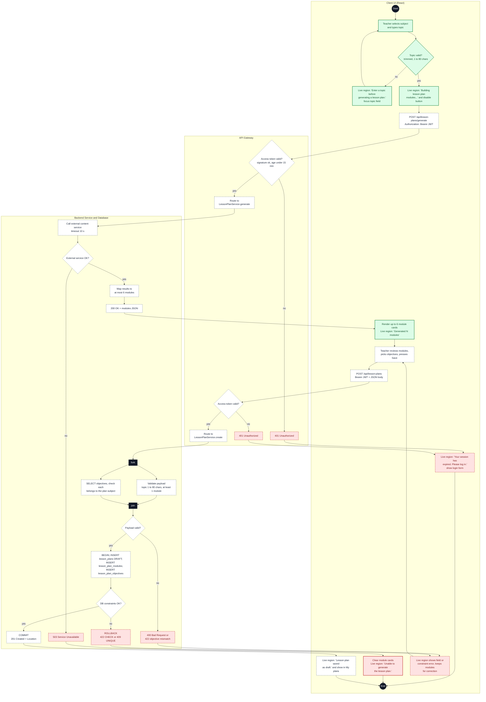

# Activity Diagram: Generate and Save a Lesson Plan

This diagram follows one teacher action from start to finish: generate modules for a topic, review them, and save the plan as a `DRAFT`. It has three swimlanes:

- **Client UI:** the React app in the browser.
- **API Gateway:** the planned HTTP entry point that checks the JWT and routes requests.
- **Backend Service & Database:** the planned LessonPlanService, the external content service, and PostgreSQL.

**Implemented vs planned.** Green nodes work today in `frontend/app.jsx`. In the prototype, the browser calls JSONPlaceholder directly, with no gateway or backend. Dashed nodes are **Planned (v0.3+)**. The diagram shows the target flow, in which generation and saving both go through the API.

## Diagram

**Legend.** Each yellow subgraph is one swimlane. Mermaid's layout engine chooses the left-to-right order of the lanes from the edges, so on GitHub the Client UI lane usually renders on the right. Green = Implemented. Dashed white = Planned (v0.3+). Red = error branch (solid border Implemented, dashed Planned). Black bars = fork / join. Black circles = start / end.

## How the prototype differs today

| Step in diagram | Prototype behaviour (Implemented) |
| --- | --- |
| U5 → G1 → G2 → B1 | The browser calls `GET https://jsonplaceholder.typicode.com/posts` directly. There is no token and no gateway. |
| B2 "no" → UE2 | A network error or non-2xx response clears the cards and announces "Unable to generate the lesson plan. …" (FR-06). |
| B3 | Mapping to 6 modules runs in the browser (`loadDashboardData` in `app.jsx`). |
| U7 → B13 (save) | Not available. There is no Save button yet. |

## Notes / Traceability

| Diagram element | FR / NFR | Status |
| --- | --- | --- |
| U1 to U3 (topic validation, focus, live region) | FR-01, FR-02, FR-03, NFR-AC1 | Implemented |
| U4, U6 (loading and success announcements) | FR-04, FR-05 | Implemented |
| B2 "no" → UE2 (clear and announce error) | FR-06 | Implemented (prototype path), Planned (`503` from API) |
| G1/G4 → G3/G6 → UE1 (token check, 401, re-login) | FR-08, FR-09, NFR-S2 | Planned (v0.3+) |
| B1 timeout 10 s, B5 `503` | NFR-P2 | Planned (v0.3+) |
| Fork B6 ∥ B7 → Join → B8 (payload and objective checks) | FR-10, FR-14 | Planned (v0.3+) |
| B10 to B13 (single transaction, rollback) | FR-10, NFR-D1, NFR-D2 | Planned (v0.3+) |
| B12 `422` / `409` (CHECK / UNIQUE violation) | FR-10, DM-04 (`lesson_plans_topic_not_blank_chk`, `lesson_plan_modules_lesson_plan_id_position_key`) | Planned (v0.3+) |

- Endpoints `POST /api/lesson-plans/generate` and `POST /api/lesson-plans` match the SRS API table (specifications.md §7.1) and the [sequence diagram](../structural/sequence.md).
- Every error branch ends in the UI live region (`role="status"`), so screen-reader users hear the outcome (NFR-AC1).
- The fork runs two independent checks (payload rules and the objective-subject match) before the join. Both must finish before the decision. In code this would be `Promise.all`.
- Related use cases: UC-01, UC-02, UC-03, UC-05, UC-07, UC-11 ([use-case.md](./use-case.md)).
