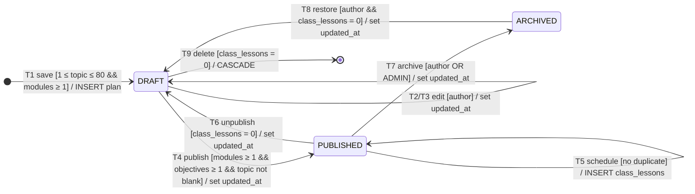
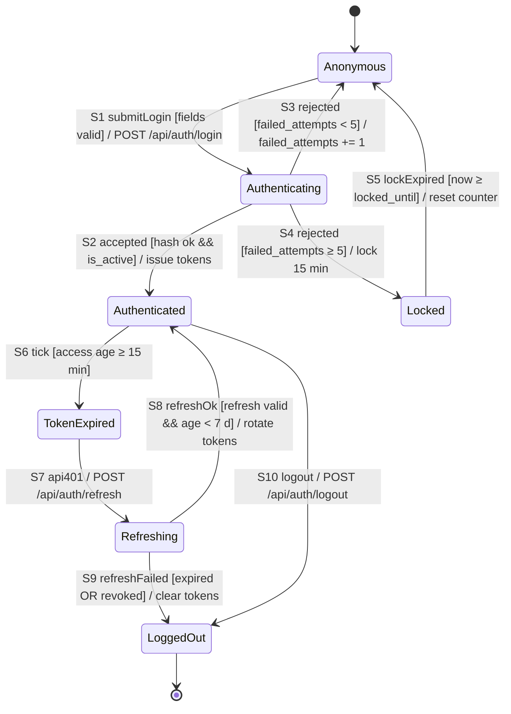

# State Machine Diagrams

This document has two state machines:

1. **LessonPlan lifecycle:** the states of one `lesson_plans` row.
2. **User session lifecycle:** the authentication states of one browser session.

Every transition is labelled `event [guard] / action`. The LessonPlan machine is **Planned (v0.3+)**: generated modules are kept in memory and have no status field yet. The session machine is **Implemented** in `server/authService.js`, `server/tokenService.js` and `frontend/apiClient.js`. The LessonPlan states are already enforced in the database by `lesson_plans_status_chk` (`status IN ('DRAFT','PUBLISHED','ARCHIVED')`).

## 1. LessonPlan lifecycle

State meanings: **DRAFT** is editable. It is the only state in which topic, grade, duration and modules may change (FR-11). **PUBLISHED** content is read-only: it can be scheduled for classes (FR-15) and reviewed by an ADMIN (FR-18). **ARCHIVED** plans are hidden from default lists, and a taught plan (`class_lessons ≥ 1`) stays ARCHIVED permanently as history. The diagram labels are shortened. The table below gives the full guard and action for each transition (T1 to T9).

### Transition table

| # | From → To | Event (API call) | Guard | Action | FR |
| --- | --- | --- | --- | --- | --- |
| T1 | [*] → DRAFT | `save` (`POST /api/lesson-plans`) | topic trimmed is 1 to 80 characters, ≥ 1 module | INSERT plan (status `DRAFT`) + modules (+ objective links) in one transaction | FR-10 |
| T2 | DRAFT → DRAFT | `edit` (`PATCH /api/lesson-plans/{id}`) | caller is author | UPDATE fields, `updated_at` | FR-11 |
| T3 | DRAFT → DRAFT | `linkObjectives` (`PUT /api/lesson-plans/{id}/objectives`) | every objective's `subject_id` = plan's `subject_id` | replace rows in `lesson_plan_objectives` | FR-14 |
| T4 | DRAFT → PUBLISHED | `publish` (`POST /api/lesson-plans/{id}/publish`) | ≥ 1 module, ≥ 1 objective, topic not blank | `status = 'PUBLISHED'`, `updated_at` | FR-12 |
| T5 | PUBLISHED → PUBLISHED | `schedule` (`POST /api/class-groups/{id}/lessons`) | class owned by caller, no duplicate (class, date, plan) | INSERT `class_lessons` | FR-15 |
| T6 | PUBLISHED → DRAFT | `unpublish` (`POST /api/lesson-plans/{id}/unpublish`) | 0 `class_lessons` | `status = 'DRAFT'` | FR-12 |
| T7 | PUBLISHED → ARCHIVED | `archive` (`POST /api/lesson-plans/{id}/archive`) | caller is author or `role = 'ADMIN'` | `status = 'ARCHIVED'` | FR-12, FR-18 |
| T8 | ARCHIVED → DRAFT | `restore` (`POST /api/lesson-plans/{id}/restore`) | caller is author, 0 `class_lessons` | `status = 'DRAFT'` | FR-12 |
| T9 | DRAFT → [*] | `delete` (`DELETE /api/lesson-plans/{id}`) | 0 `class_lessons` | DELETE. Modules and objective links CASCADE, quizzes and decks SET NULL. | FR-19 |

Any event not listed for the current state, such as `edit` on PUBLISHED or `publish` on ARCHIVED, is rejected with `409 Conflict`, and the status does not change.

### Why these transitions

- **Unpublish (T6)** lets a teacher fix a mistake found right after publishing. It is only allowed while the plan has never been taught, because once `class_lessons` exist the plan is the record of what was delivered.
- **Restore (T8)** returns an archived plan to DRAFT, not to PUBLISHED, so that it is checked again by the publish guard (T4). Taught plans cannot be restored, for the same reason as T6. The database already enforces this half of the rule: `class_lessons.lesson_plan_id` is `ON DELETE RESTRICT`.
- **No DRAFT → ARCHIVED.** A draft that is not wanted is deleted (T9). Archiving exists for content that was visible to others.
- **Delete only from DRAFT (T9).** A plan reaches PUBLISHED before it can be scheduled (T5), and it can only return to DRAFT without schedules (T6, T8). So any plan in DRAFT has 0 `class_lessons`, and the FK RESTRICT will not block the delete. The guard is still checked explicitly as a second line of defence.

## 2. User session lifecycle

### Transition table

| # | From → To | Event | Guard | Action |
| --- | --- | --- | --- | --- |
| S1 | Anonymous → Authenticating | `submitLogin(email, password)` | email format valid, password not empty | `POST /api/auth/login`, live region "Signing in..." |
| S2 | Authenticating → Authenticated | `accepted` (`200`) | bcrypt hash matches, `is_active = true`, not locked | Issue 15-min access JWT and 7-day refresh token. `failed_attempts = 0`. |
| S3 | Authenticating → Anonymous | `rejected` (`401`, or `403` for inactive users) | `failed_attempts < 5` | `failed_attempts += 1`. Show "Email or password is incorrect" (or "Account disabled" for `403`). |
| S4 | Authenticating → Locked | `rejected` (`423`) | `failed_attempts ≥ 5` within 15 min | `locked_until = now + 15 min` |
| S5 | Locked → Anonymous | `lockExpired` | `now ≥ locked_until` | `failed_attempts = 0` |
| S6 | Authenticated → TokenExpired | time passes | access token age ≥ 15 min | none (detected on the next API call) |
| S7 | TokenExpired → Refreshing | API call returns `401` | none | `POST /api/auth/refresh` |
| S8 | Refreshing → Authenticated | `refreshOk` (`200`) | refresh token valid, not revoked, age < 7 days | Rotate both tokens and retry the original request once |
| S9 | Refreshing → LoggedOut | `refreshFailed` (`401`) | refresh token expired or revoked | Clear tokens. Live region "Your session has expired." |
| S10 | Authenticated → LoggedOut | `logout` | none | `POST /api/auth/logout` → `204`, refresh token revoked |

### State descriptions

| State | Meaning | UI shows |
| --- | --- | --- |
| Anonymous | No tokens. Only the public generator (FR-01 to FR-06) is available. | Login / Sign-up buttons |
| Authenticating | Login request in flight | Disabled form, live region "Signing in..." |
| Authenticated | Valid access token in memory and refresh token stored | User name, My plans |
| TokenExpired | Access token older than 15 min. The next API call gets `401`. | Nothing visible yet |
| Refreshing | Refresh request in flight | Original action shows its loading text |
| Locked | 5 failed logins within 15 min | "Too many attempts. Try again in 15 minutes." |
| LoggedOut | Tokens cleared or revoked | Login form with the reason in the live region |

## Notes / Traceability

| Element | FR / NFR | DB artefact | Status |
| --- | --- | --- | --- |
| States DRAFT, PUBLISHED, ARCHIVED | FR-12 | `lesson_plans.status` + `lesson_plans_status_chk` | Planned (v0.3+). The CHECK constraint is Implemented. |
| T1 save guard | FR-02, FR-03, FR-10 | `lesson_plans_topic_not_blank_chk`, `topic VARCHAR(80)` | Planned (v0.3+) |
| T4 publish guard (objectives ≥ 1) | FR-12, FR-14 | `lesson_plan_objectives` | Planned (v0.3+) |
| T5 schedule, T6/T8/T9 `class_lessons = 0` guards | FR-12, FR-15, FR-19 | `class_lessons` UNIQUE + `ON DELETE RESTRICT` | Planned (v0.3+) |
| T7 archive by ADMIN | FR-18 | `users.role` + `users_role_chk` | Planned (v0.3+) |
| T9 delete actions | FR-19 | CASCADE on modules and objectives, SET NULL on `quizzes.lesson_plan_id` and `flashcard_decks.lesson_plan_id` | Planned (v0.3+) |
| Session machine | FR-07, FR-08, FR-09, NFR-S2, NFR-S5 | `users.is_active`, `users.failed_login_attempts`, `users.last_failed_login_at`, `users.locked_until`, `refresh_tokens` (v0.3 migration `20261126000000_auth_sessions`) | Implemented. The refresh token is kept in an HttpOnly cookie and the access token in page memory. |

- Event names map one-to-one to the endpoints in specifications.md §7.1 and to the methods `publish()`, `unpublish()`, `archive()`, `restore()` and `canPublish()` on `LessonPlan` in the [class diagram](../structural/class-diagram.md).
- Related use cases: UC-07, UC-08, UC-09, UC-11, UC-12, UC-16, UC-17 (lesson plan) and UC-04, UC-05, UC-06 (session).
