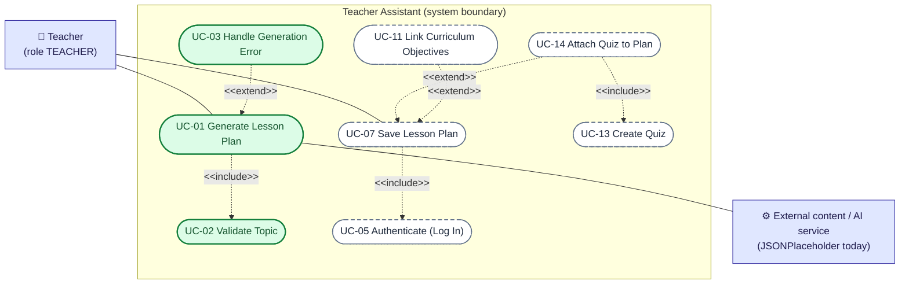
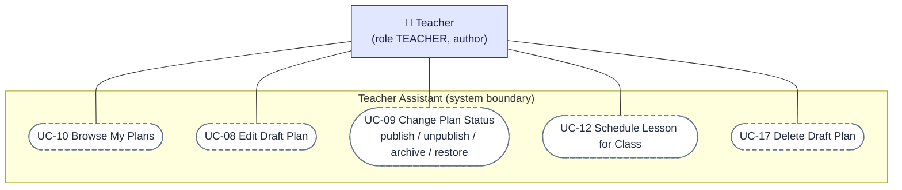
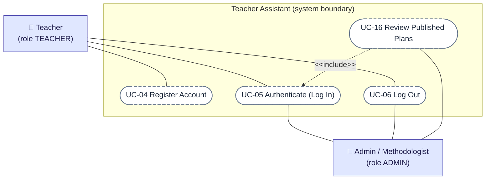
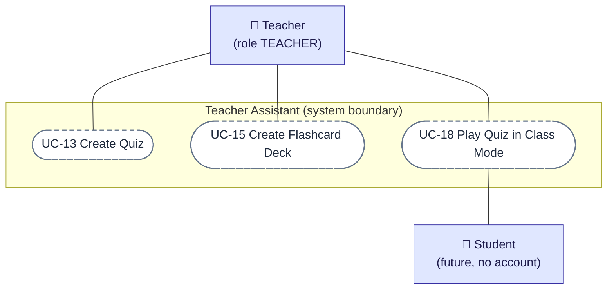

# Use Case Diagram and Specifications

This document shows who uses Teacher Assistant and for what. There are four actors and 18 use cases. Each use case is specified as a table after the diagrams. Requirement IDs (FR-xx) refer to [../../specifications.md](../../specifications.md).

Mermaid has no native use-case diagram type, so the diagrams are drawn as flowcharts:

- Actors are rectangles outside the `Teacher Assistant` subgraph (the system boundary).
- Use cases are stadium (ellipse-like) nodes inside it.
- Solid lines connect actors to the use cases they take part in.
- Dashed arrows labelled «include» / «extend» follow UML direction: an include arrow points from the base use case to the included one, and an extend arrow points from the extension to the base use case.
- Green use cases are **Implemented**. Dashed-border use cases are **Planned (v0.3+)**.

One diagram with all 18 use cases did not lay out legibly in Mermaid, so the model is shown as **four views of the same system**. A use case that appears in two views (UC-05, UC-13) is the same use case.

## Diagram A: Generate and save a lesson plan

## Diagram B: Manage lesson plans

## Diagram C: Accounts and methodologist review

## Diagram D: Assessment and edu-games

**Reading notes**

- Totals across the four views: 4 actors, 18 use cases, 4 «include» relationships (UC-01→UC-02, UC-07→UC-05, UC-16→UC-05, UC-14→UC-13) and 3 «extend» relationships (UC-03→UC-01, UC-14→UC-07, UC-11→UC-07).
- Every planned Teacher and Admin use case has the precondition "actor is authenticated". The «include» to UC-05 is drawn only for UC-07 and UC-16, so the views stay readable. The tables below state the precondition for every use case.
- The External service is a secondary actor: the system calls it, it never starts a use case.

## Use Case Specifications

### UC-01 Generate Lesson Plan: Implemented

| Field | Value |
| --- | --- |
| Actor(s) | Teacher (primary), External content / AI service (secondary) |
| Preconditions | The generator page is loaded (FR-01). Today no login is needed. From v0.3, the server-side version requires an authenticated session. |
| Trigger | Teacher presses **Generate Lesson Plan** |
| Main flow | 1. Teacher selects a subject. 2. Teacher types a topic. 3. Teacher submits the form. 4. The system validates the topic (includes UC-02). 5. The system shows "Building lesson plan modules..." in the live region and disables the button. 6. The system requests content from the external service. 7. The system maps up to six results to modules with title, subject, target grade, objectives, duration and activities. 8. The system renders the module cards and announces "Generated N lesson plan modules for <topic>." |
| Alternative / exception flows | 4a. Topic invalid: see UC-02, and generation stops. 6a. Service fails or returns non-2xx: extended by UC-03. 3a. A request is already running: the submit is ignored. |
| Postconditions | Success: 1 to 6 module cards are visible, and the module count is updated. Nothing is persisted (in-memory only). |
| Includes / Extends | Includes UC-02. Extended by UC-03. |
| Related FRs | FR-01, FR-04, FR-05 |

### UC-02 Validate Topic: Implemented

| Field | Value |
| --- | --- |
| Actor(s) | none directly (included by UC-01). Server-side check in UC-07 is Planned. |
| Preconditions | The form has been submitted. |
| Trigger | Included by UC-01 step 4 |
| Main flow | 1. The system trims the topic. 2. The system checks the length is between 1 and 80 characters. 3. Validation passes and control returns to UC-01. |
| Alternative / exception flows | 2a. The topic is empty: the browser's native `required` message blocks submission. 2b. The topic is whitespace-only: the live region says "Enter a topic before generating a lesson plan.", focus moves to the topic field, and no request is sent. 2c. More than 80 characters cannot be typed (`maxLength=80`). The planned API returns `400`. |
| Postconditions | Either a valid trimmed topic, or no request sent and an error announced. |
| Includes / Extends | Included by UC-01 |
| Related FRs | FR-02, FR-03 |

### UC-03 Handle Generation Error: Implemented

| Field | Value |
| --- | --- |
| Actor(s) | Teacher (receives feedback), External service (fails) |
| Preconditions | UC-01 reached step 6. |
| Trigger | The network fails, or the service returns a non-2xx status. |
| Main flow | 1. The system catches the error. 2. The system clears the previously generated modules. 3. The system announces "Unable to generate the lesson plan. <reason>" in the live region. 4. The system re-enables the button. |
| Alternative / exception flows | none |
| Postconditions | 0 module cards are visible. The teacher can retry. |
| Includes / Extends | Extends UC-01 at the extension point "content request failed" |
| Related FRs | FR-06 |

### UC-04 Register Account: Planned (v0.3+)

| Field | Value |
| --- | --- |
| Actor(s) | Teacher (not yet registered) |
| Preconditions | The visitor is anonymous. |
| Trigger | Visitor opens **Sign up** |
| Main flow | 1. Visitor enters email, first name, last name and password. 2. The system validates the fields (email format, password ≥ 8 characters, names not blank). 3. The system sends `POST /api/auth/register`. 4. The server stores a bcrypt hash (cost ≥ 12) with role `TEACHER`. 5. The server returns `201`, and the UI announces "Account created. Please log in." |
| Alternative / exception flows | 2a. Invalid field: a field-level error is shown and nothing is sent. 4a. The email already exists: `409`, and the UI says "This email is already registered." |
| Postconditions | A new row in `users` with `role = 'TEACHER'` and `is_active = true` |
| Includes / Extends | none |
| Related FRs | FR-07 |

### UC-05 Authenticate (Log In): Planned (v0.3+)

| Field | Value |
| --- | --- |
| Actor(s) | Teacher, Admin |
| Preconditions | The user has an account. The session is Anonymous (see the session state machine). |
| Trigger | The user submits the login form, or an included use case needs a session. |
| Main flow | 1. The user enters email and password. 2. The UI sends `POST /api/auth/login`. 3. The server verifies the bcrypt hash and `is_active`. 4. The server returns `200` with a 15-minute access JWT and a 7-day refresh token. 5. The UI stores the session and continues the original use case. |
| Alternative / exception flows | 3a. Wrong credentials: `401`, and the failed-attempt counter increases. 3b. 5th failure within 15 minutes: `423 Locked` for 15 minutes. 3c. Inactive user: `403`. |
| Postconditions | The session state is Authenticated. |
| Includes / Extends | Included by UC-07 and UC-16 (and, by precondition, every planned teacher and admin use case) |
| Related FRs | FR-08 |

### UC-06 Log Out: Planned (v0.3+)

| Field | Value |
| --- | --- |
| Actor(s) | Teacher, Admin |
| Preconditions | The session is Authenticated. |
| Trigger | The user presses **Log out**, or the refresh token has expired. |
| Main flow | 1. The UI sends `POST /api/auth/logout` with the refresh token. 2. The server revokes the token and returns `204`. 3. The UI clears tokens and shows the login page. |
| Alternative / exception flows | 1a. Refresh token expired or revoked: `POST /api/auth/refresh` returns `401`, and the UI goes straight to step 3 with the message "Your session has expired." |
| Postconditions | The session state is LoggedOut, and the refresh token is unusable. |
| Includes / Extends | none |
| Related FRs | FR-09 |

### UC-07 Save Lesson Plan: Planned (v0.3+)

| Field | Value |
| --- | --- |
| Actor(s) | Teacher |
| Preconditions | UC-01 succeeded (modules on screen). |
| Trigger | Teacher presses **Save plan** |
| Main flow | 1. The system ensures an authenticated session (includes UC-05). 2. The UI sends `POST /api/lesson-plans` with a Bearer token and a JSON body (subjectId, topic, gradeLevel, durationMinutes, modules[], objectiveIds[]). 3. The server validates the payload. 4. The server inserts `lesson_plans` (status `DRAFT`), `lesson_plan_modules` and `lesson_plan_objectives` in one transaction. 5. The server returns `201 Created` with `Location`. 6. The UI announces "Lesson plan saved as draft." |
| Alternative / exception flows | 1a. Token missing or expired: `401`, the UI refreshes once and otherwise asks for login. 3a. Blank topic or more than 80 characters: `400`. 4a. CHECK violation: rollback and `422`. 4b. Duplicate module position: `409`. 4c. Database unavailable: `503`, and the UI offers a retry. |
| Postconditions | One `DRAFT` plan with ≥ 1 module is persisted, or nothing is persisted. |
| Includes / Extends | Includes UC-05. Extended by UC-11 and UC-14. |
| Related FRs | FR-10 |

### UC-08 Edit Draft Plan: Planned (v0.3+)

| Field | Value |
| --- | --- |
| Actor(s) | Teacher (author) |
| Preconditions | Authenticated. The plan exists with status `DRAFT`, and the caller is its author. |
| Trigger | Teacher opens a draft and presses **Save changes** |
| Main flow | 1. Teacher changes the topic, grade, duration or modules. 2. The UI validates the fields. 3. The UI sends `PATCH /api/lesson-plans/{id}`. 4. The server updates the rows and `updated_at`, then returns `200`. 5. The UI announces "Changes saved." |
| Alternative / exception flows | 4a. The plan is not `DRAFT`: `409` "Unpublish the plan before editing." 4b. The caller is not the author: `403`. |
| Postconditions | The draft is updated. |
| Includes / Extends | none |
| Related FRs | FR-11 |

### UC-09 Change Plan Status: Planned (v0.3+)

| Field | Value |
| --- | --- |
| Actor(s) | Teacher (author) |
| Preconditions | Authenticated author of the plan |
| Trigger | Teacher presses **Publish**, **Unpublish**, **Archive** or **Restore** |
| Main flow | 1. The UI sends `POST /api/lesson-plans/{id}/{publish\|unpublish\|archive\|restore}`. 2. The server checks the transition guard from the LessonPlan state machine. 3. The server updates `status` and `updated_at`, then returns `200`. 4. The UI shows the new status as text and a badge. |
| Alternative / exception flows | 2a. Guard fails (e.g. publish with 0 objectives, or unpublish a taught plan): `409` with the reason in the live region. |
| Postconditions | `status` is one of `DRAFT`, `PUBLISHED` or `ARCHIVED`. |
| Includes / Extends | none |
| Related FRs | FR-12 |

### UC-10 Browse My Plans: Planned (v0.3+)

| Field | Value |
| --- | --- |
| Actor(s) | Teacher |
| Preconditions | Authenticated |
| Trigger | Teacher opens **My plans** |
| Main flow | 1. The UI sends `GET /api/lesson-plans?page=1`. 2. The server returns ≤ 20 own plans, newest first. 3. The UI lists them with topic, subject, grade and status. 4. The teacher can filter by status or open the next page. |
| Alternative / exception flows | 2a. No plans: the empty state says "You have no lesson plans yet." |
| Postconditions | none (read only) |
| Includes / Extends | none |
| Related FRs | FR-13 |

### UC-11 Link Curriculum Objectives: Planned (v0.3+)

| Field | Value |
| --- | --- |
| Actor(s) | Teacher |
| Preconditions | Authenticated. The plan is being saved or is a `DRAFT`. |
| Trigger | Teacher ticks objectives in the objective picker |
| Main flow | 1. The UI loads the objectives for the plan's subject and grade. 2. Teacher selects one or more. 3. The UI sends `PUT /api/lesson-plans/{id}/objectives` (or includes `objectiveIds` in UC-07). 4. The server replaces the `lesson_plan_objectives` rows and returns `200`. |
| Alternative / exception flows | 4a. An objective belongs to another subject: `422`. |
| Postconditions | The plan is linked to ≥ 1 objective (needed to publish). |
| Includes / Extends | Extends UC-07 at "plan saved" |
| Related FRs | FR-14 |

### UC-12 Schedule Lesson for Class: Planned (v0.3+)

| Field | Value |
| --- | --- |
| Actor(s) | Teacher |
| Preconditions | Authenticated. The plan is `PUBLISHED`, and the teacher owns the class group. |
| Trigger | Teacher picks a class and date and presses **Schedule** |
| Main flow | 1. The UI sends `POST /api/class-groups/{id}/lessons` with `lessonPlanId` and `scheduledOn`. 2. The server inserts a `class_lessons` row and returns `201`. 3. The UI announces "Scheduled for 7A on 2026-09-03." |
| Alternative / exception flows | 2a. Same plan, class and date already booked: `409`. 2b. Plan not `PUBLISHED`: `409`. 2c. The class grade differs from the plan grade: a warning, but the lesson is still scheduled. |
| Postconditions | The plan has ≥ 1 `class_lessons` row, so it can no longer be unpublished or deleted. |
| Includes / Extends | none |
| Related FRs | FR-15 |

### UC-13 Create Quiz: Planned (v0.3+)

| Field | Value |
| --- | --- |
| Actor(s) | Teacher |
| Preconditions | Authenticated |
| Trigger | Teacher presses **New quiz** |
| Main flow | 1. Teacher enters a title and an optional time limit (30 to 7200 s). 2. Teacher adds questions with type, points and options. 3. The UI checks each question has ≥ 2 options and ≥ 1 correct option. 4. The UI sends `POST /api/quizzes`. 5. The server inserts the quiz, questions and options in one transaction and returns `201`. |
| Alternative / exception flows | 3a or 5a. Rule broken: `400` with the question number in the message. |
| Postconditions | The quiz is persisted, with `lesson_plan_id` null or set. |
| Includes / Extends | Included by UC-14 |
| Related FRs | FR-16 |

### UC-14 Attach Quiz to Plan: Planned (v0.3+)

| Field | Value |
| --- | --- |
| Actor(s) | Teacher |
| Preconditions | UC-07 completed (the plan has an id). |
| Trigger | After saving, the teacher chooses **Create a quiz from this plan** |
| Main flow | 1. The system pre-fills the quiz title from the plan topic. 2. Create the quiz (includes UC-13) with `lessonPlanId` set. |
| Alternative / exception flows | If the plan is later deleted, `quizzes.lesson_plan_id` becomes `NULL` (SET NULL) and the quiz survives. |
| Postconditions | The quiz is linked to the plan. |
| Includes / Extends | Extends UC-07. Includes UC-13. |
| Related FRs | FR-16 |

### UC-15 Create Flashcard Deck: Planned (v0.3+)

| Field | Value |
| --- | --- |
| Actor(s) | Teacher |
| Preconditions | Authenticated |
| Trigger | Teacher presses **New deck** |
| Main flow | 1. Teacher enters a title and optionally picks a plan. 2. Teacher adds cards (front and back). 3. The UI sends `POST /api/flashcard-decks`. 4. The server returns `201`. |
| Alternative / exception flows | 3a. A blank side: `400`. |
| Postconditions | The deck and its cards are persisted. |
| Includes / Extends | none |
| Related FRs | FR-17 |

### UC-16 Review Published Plans: Planned (v0.3+)

| Field | Value |
| --- | --- |
| Actor(s) | Admin / Methodologist |
| Preconditions | Authenticated with `role = 'ADMIN'` (includes UC-05) |
| Trigger | Admin opens **Review** |
| Main flow | 1. The UI sends `GET /api/admin/lesson-plans?subjectId=&gradeLevel=`. 2. The server returns `PUBLISHED` plans of all teachers. 3. Admin opens a plan and checks its objectives. 4. If it is non-compliant, Admin presses **Archive**, which sends `POST /api/lesson-plans/{id}/archive`. 5. The status becomes `ARCHIVED`. |
| Alternative / exception flows | 1a. The caller is a TEACHER: `403`. |
| Postconditions | The reviewed plan stays `PUBLISHED` or becomes `ARCHIVED`. Review comments are not stored (out of scope). |
| Includes / Extends | Includes UC-05 |
| Related FRs | FR-18 |

### UC-17 Delete Draft Plan: Planned (v0.3+)

| Field | Value |
| --- | --- |
| Actor(s) | Teacher (author) |
| Preconditions | Authenticated author. The plan is `DRAFT` and has never been scheduled. |
| Trigger | Teacher presses **Delete** and confirms in an on-page dialog |
| Main flow | 1. The UI sends `DELETE /api/lesson-plans/{id}`. 2. The server deletes the plan. Modules and objective links CASCADE, and quizzes and decks are SET NULL. 3. The server returns `204`, and the UI announces "Draft deleted." |
| Alternative / exception flows | 2a. The plan has `class_lessons`: FK RESTRICT gives `409` "This plan has been taught; archive it instead." |
| Postconditions | The plan and its parts are gone. Linked quizzes and decks remain as standalone. |
| Includes / Extends | none |
| Related FRs | FR-19 |

### UC-18 Play Quiz in Class Mode: Planned (v0.4+)

| Field | Value |
| --- | --- |
| Actor(s) | Teacher (operates), Student (views and answers aloud) |
| Preconditions | Authenticated teacher with at least one quiz. The projector shows the teacher's screen. |
| Trigger | Teacher presses **Play in class** |
| Main flow | 1. The system shows question 1 full-screen. 2. Students answer aloud or on paper. 3. Teacher presses **Reveal**, and correct options are marked with ✓ and text. 4. Teacher presses **Next**, repeating until the last question. |
| Alternative / exception flows | 1a. The quiz has no questions: "This quiz is empty." |
| Postconditions | Nothing is stored (no attempts, out of scope). |
| Includes / Extends | none |
| Related FRs | FR-20 |

## Notes / Traceability

| Use case | FRs | Status | Other diagrams |
| --- | --- | --- | --- |
| UC-01 | FR-01, FR-04, FR-05 | Implemented | [activity](./activity.md) |
| UC-02 | FR-02, FR-03 | Implemented | [activity](./activity.md), [sequence](../structural/sequence.md) (400 branch) |
| UC-03 | FR-06 | Implemented | [activity](./activity.md) |
| UC-04 | FR-07 | Planned (v0.3+) | [state-machine](./state-machine.md) (session) |
| UC-05 | FR-08 | Planned (v0.3+) | [state-machine](./state-machine.md), [sequence](../structural/sequence.md) (login) |
| UC-06 | FR-09 | Planned (v0.3+) | [state-machine](./state-machine.md) |
| UC-07 | FR-10 | Planned (v0.3+) | [activity](./activity.md), [sequence](../structural/sequence.md), [state-machine](./state-machine.md) |
| UC-08 | FR-11 | Planned (v0.3+) | [state-machine](./state-machine.md) |
| UC-09 | FR-12 | Planned (v0.3+) | [state-machine](./state-machine.md) |
| UC-10 | FR-13 | Planned (v0.3+) | [class-diagram](../structural/class-diagram.md) |
| UC-11 | FR-14 | Planned (v0.3+) | [class-diagram](../structural/class-diagram.md) |
| UC-12 | FR-15 | Planned (v0.3+) | [state-machine](./state-machine.md) |
| UC-13, UC-14 | FR-16 | Planned (v0.3+) | [class-diagram](../structural/class-diagram.md) |
| UC-15 | FR-17 | Planned (v0.3+) | [class-diagram](../structural/class-diagram.md) |
| UC-16 | FR-18 | Planned (v0.3+) | [state-machine](./state-machine.md) |
| UC-17 | FR-19 | Planned (v0.3+) | [state-machine](./state-machine.md) |
| UC-18 | FR-20 | Planned (v0.4+) | [class-diagram](../structural/class-diagram.md) |

Coverage check: FR-01 to FR-20 each appear in at least one use case, and all 18 use cases appear in the SRS traceability matrix (specifications.md §8).
