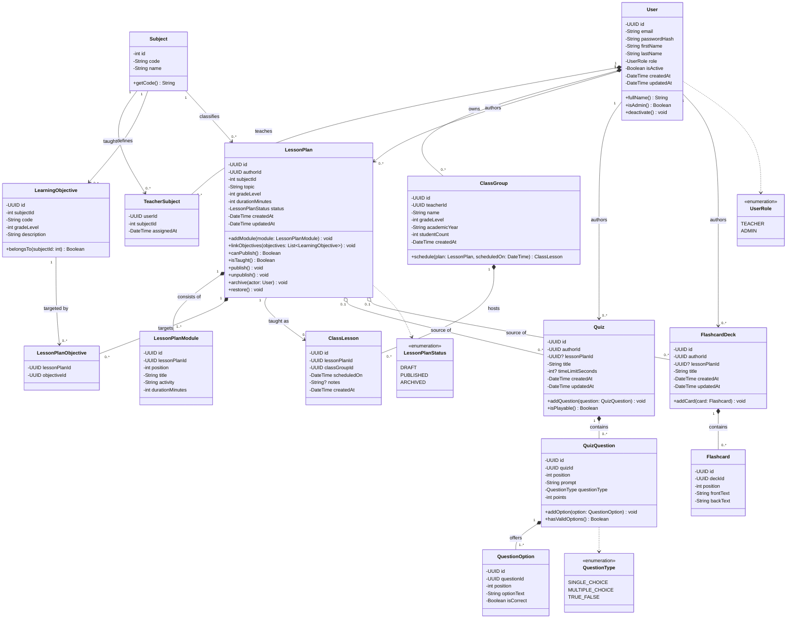
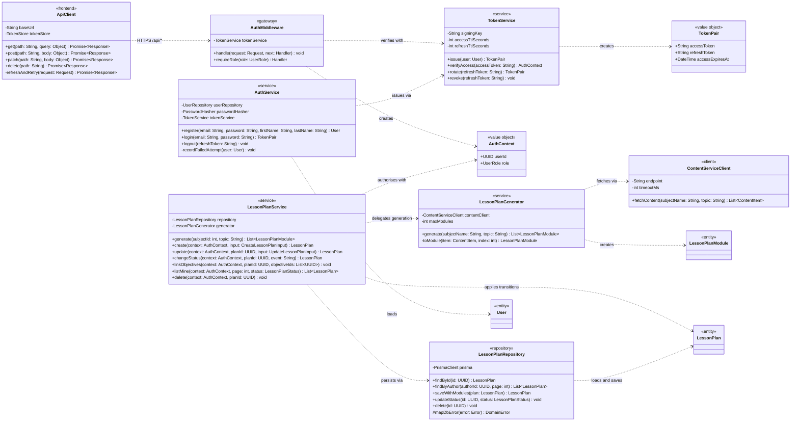

# Class Diagram

The class model has two views:

1. **Domain model:** one class per Prisma model (14) and three enumerations. Attribute names are the Prisma field names, with the database column in `snake_case` (see [database-schema.md](../../database-schema.md)). Types map as follows: `String @db.Uuid` → `UUID`, `Int` / `SmallInt` → `int`, `DateTime` (`@db.Timestamptz` / `@db.Date`) → `DateTime`, `Boolean` → `Boolean`, `String` / `Text` / `VarChar` → `String`. A trailing `?` marks an optional (nullable) attribute.
2. **Services and dependencies:** the service, repository and client classes from the [CRC cards](./crc-cards.md) and how they depend on the domain.

Visibility: `-` private, `+` public, `#` protected. Attributes are private and exposed through methods. Value objects (`AuthContext`, `TokenPair`) have public read-only fields.

**Status.** All domain **attributes** are Implemented as the Prisma schema. All **methods** and every class in view 2 are **Planned (v0.3+)**.

## View 1: Domain model

## View 2: Services and dependencies

## Notes / Traceability

### Why composition, aggregation or association

The relationship kind follows the foreign key's `ON DELETE` rule in the migration, so the diagram and the database cannot disagree.

| Kind | Mermaid | Used for | FK rule | Reason |
| --- | --- | --- | --- | --- |
| **Composition** (filled diamond) | `*--` | LessonPlan → LessonPlanModule, LessonPlan → LessonPlanObjective, Quiz → QuizQuestion, QuizQuestion → QuestionOption, FlashcardDeck → Flashcard, ClassGroup → ClassLesson, User → ClassGroup, User → TeacherSubject | `ON DELETE CASCADE` | The part cannot exist without the whole and is deleted with it. |
| **Aggregation** (hollow diamond) | `o--` | LessonPlan → Quiz, LessonPlan → FlashcardDeck | `ON DELETE SET NULL`, FK nullable | The plan "has" quizzes and decks, but they outlive it as standalone games. Multiplicity `0..1` on the plan side. |
| **Association** (arrow) | `-->` | User → LessonPlan / Quiz / FlashcardDeck, Subject → LessonPlan / LearningObjective / TeacherSubject, LearningObjective → LessonPlanObjective, LessonPlan → ClassLesson | `ON DELETE RESTRICT` | Independent lifecycles: the referenced object must not be deleted while it is in use. |
| **Dependency** (dashed) | `..>` | Entities → enums, and every service arrow in View 2 | none | Uses the type, but does not own a reference to it. |

### Cardinalities vs Prisma

| Association | Cardinality | Prisma evidence |
| --- | --- | --- |
| User → LessonPlan | `1` to `0..*` | `LessonPlan.authorId String` (required) + `User.lessonPlans LessonPlan[]` |
| LessonPlan → LessonPlanModule | `1` to `1..*` | required `lessonPlanId`. The minimum of 1 is a business rule (FR-10, state-machine guard T1). |
| LessonPlan → Quiz | `0..1` to `0..*` | `Quiz.lessonPlanId String?`, `onDelete: SetNull` |
| QuizQuestion → QuestionOption | `1` to `1..*` | required `questionId`. The "≥ 2 options" business rule is in `hasValidOptions()` (FR-16). |
| LessonPlan ↔ LearningObjective | N:M through `LessonPlanObjective` | `@@id([lessonPlanId, objectiveId])` |
| LessonPlan ↔ ClassGroup | N:M through `ClassLesson` | `@@unique([classGroupId, scheduledOn, lessonPlanId])` |
| User ↔ Subject | N:M through `TeacherSubject` | `@@id([userId, subjectId])` |

### Other notes

- **Enums.** `UserRole`, `LessonPlanStatus` and `QuestionType` are stored as `VARCHAR` with CHECK constraints (`users_role_chk`, `lesson_plans_status_chk`, `quiz_questions_type_chk`), not as PostgreSQL enums. Their values are identical to the enum literals here.
- **State machine.** `LessonPlan.publish()`, `unpublish()`, `archive(actor)` and `restore()` implement transitions T4, T6, T7 and T8 from the [state machine](../behavioral/state-machine.md). `canPublish()` is the T4 guard.
- **Supporting types.** View 2 names some types without drawing them: `Request`, `Response`, `Handler`, `TokenStore`, `PrismaClient`, `ContentItem`, `CreateLessonPlanInput`, `UpdateLessonPlanInput`, `DomainError`, `UserRepository` and `PasswordHasher`. They are framework or DTO types, left out to keep the diagram readable.
- **Planned columns.** Session fields (`failedLoginAttempts`, `lockedUntil`, refresh tokens) are not in the current schema and are therefore not drawn on `User`. They arrive with the v0.3 migration (see the [SRS](../../specifications.md) schema note).
- Traceability: View 1 implements DM-01 to DM-04 in UML form. View 2 covers FR-01 to FR-19 through the use cases listed in [crc-cards.md](./crc-cards.md#notes--traceability).
