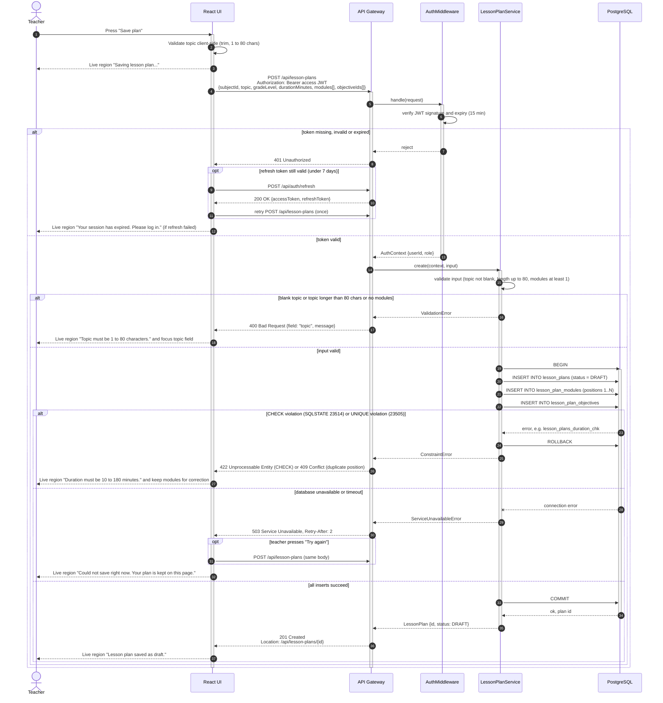
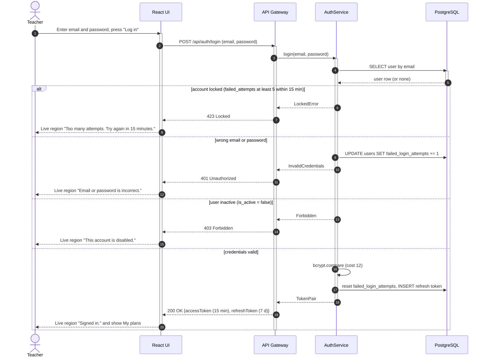

# Sequence Diagrams

Sequence diagrams show the order of messages between objects for one scenario. This document has two:

1. **SEQ-1: Teacher saves a generated lesson plan** (`POST /api/lesson-plans`), with every failure branch.
2. **SEQ-2: Teacher logs in** (`POST /api/auth/login`), with lockout.

**Status: Planned (v0.3+).** No API, gateway or authentication exists yet. The only Implemented parts are the client-side topic check (FR-02, FR-03) and the live status region (FR-05, FR-06), which these diagrams reuse. Endpoints and status codes match the SRS API table ([specifications.md §7.1](../../specifications.md#71-planned-rest-api-surface-v03)) and the [activity diagram](../behavioral/activity.md).

## SEQ-1: Teacher saves a generated lesson plan

Precondition: the teacher has generated modules on screen (UC-01) and holds an access token (UC-05).

### Branch summary

| Branch | HTTP status | Cause | Live-region message | Rows persisted |
| --- | --- | --- | --- | --- |
| Token invalid | `401` | Missing or expired access token, and the refresh failed | "Your session has expired. Please log in." | 0 |
| Validation | `400` | Blank topic, topic > 80 characters, 0 modules (FR-02, FR-03, FR-10) | "Topic must be 1 to 80 characters." | 0 |
| Constraint | `422` / `409` | CHECK (`lesson_plans_duration_chk`, `lesson_plans_topic_not_blank_chk` …) or UNIQUE (`lesson_plan_modules_lesson_plan_id_position_key`) | Specific field message | 0 (ROLLBACK) |
| Infrastructure | `503` | Database down or timeout | "Could not save right now. Your plan is kept on this page." | 0 |
| Success | `201` | none | "Lesson plan saved as draft." | 1 plan + N modules + M objective links |

## SEQ-2: Teacher logs in

## Notes / Traceability

| Message / branch | FR / NFR | Status |
| --- | --- | --- |
| Client-side topic check (SEQ-1 step 2) | FR-02, FR-03 | Implemented (in the generator form today) |
| Live-region updates in every branch | FR-05, FR-06, NFR-AC1 | Implemented (live region), Planned (new messages) |
| `POST /api/lesson-plans` → `201` | FR-10, UC-07 | Planned (v0.3+) |
| `401` + `opt` refresh | FR-09, NFR-S2, UC-05/UC-06 | Planned (v0.3+) |
| `400` validation | FR-02, FR-03, FR-10 | Planned (v0.3+) |
| `422` / `409` + ROLLBACK | FR-10, NFR-D1, NFR-D2, DM-04 | Planned (v0.3+). The CHECK and UNIQUE constraints themselves are Implemented. |
| `503` + `opt` retry | NFR-A1, NFR-P1 | Planned (v0.3+) |
| SEQ-2 `POST /api/auth/login`, `423` lockout | FR-08, NFR-S1, NFR-S5, UC-05 | Planned (v0.3+). Needs the `failed_login_attempts` / `locked_until` / refresh-token migration. |

- Participants match the [class diagram](./class-diagram.md): `AuthMiddleware`, `AuthService` and `LessonPlanService` are the same classes. The API Gateway is the HTTP layer that hosts `AuthMiddleware`. `LessonPlanRepository` is folded into the `LessonPlanService` → PostgreSQL messages to keep SEQ-1 readable.
- PostgreSQL error codes: `23514` check_violation, `23505` unique_violation, `23503` foreign_key_violation (the last one is used by delete, FR-19).
